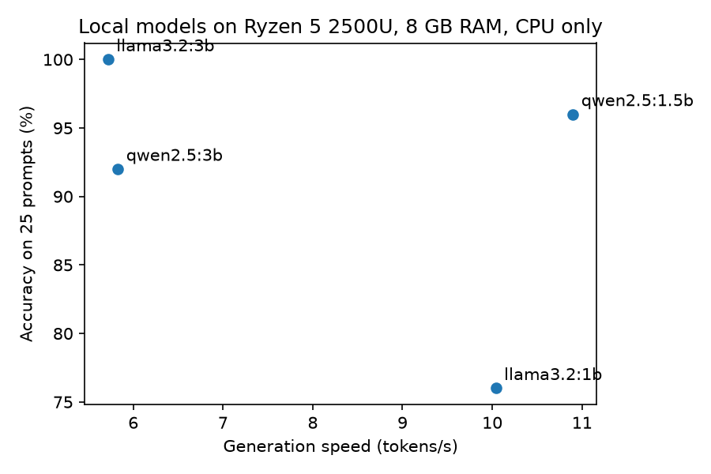

# Small local LLMs on a modest Windows laptop: a benchmark and an access-risk experiment

Two Jupyter notebooks exploring what small open models can do when run **fully locally** (via [Ollama](https://ollama.com)) on an ordinary 8 GB laptop with no usable GPU:

1. **`01_benchmark.ipynb`** compares four small models on speed, memory and answer quality.
2. **`02_sod_detection.ipynb`** tests whether those models can flag segregation-of-duties violations in synthetic purchase-order data (for example, the same person creating a PO and processing its payment), and compares them with a plain pandas rule.

This is a small learning project. The data is synthetic, the samples are small, and the results should be read as such (see [Limitations](#limitations)).

## Summary

- On a CPU-only Ryzen 5 2500U with 8 GB RAM, the 1B/1.5B models generate about 10-11 tokens/s and the 3B models about 5.7-5.8 tokens/s. A 60-token answer takes roughly 6-10 seconds.
- On a 25-prompt quality check, `llama3.2:3b` scored 100%, `qwen2.5:1.5b` 96%, `qwen2.5:3b` 92% and `llama3.2:1b` 76%. With 25 prompts, small differences are noise.
- On the access-risk task, none of the three models I tested was usable as a detector. Zero-shot, each behaved like a constant classifier (always yes or always no). With few-shot examples, one model's good development-set score (F1 0.95 on 27 rows) fell to F1 0.39 on held-out rows.
- For exact-match checks like these, a deterministic rule in pandas is the right tool. The more interesting finding was *where* the models failed (see below).

## Hardware and software

| | |
|---|---|
| CPU | AMD Ryzen 5 2500U (4 cores / 8 threads) |
| RAM | 8 GB (single-channel DDR4-2400, about 7 GB usable) |
| GPU | Integrated Radeon Vega 8; not used by Ollama on Windows, so all runs were CPU-only |
| OS | Windows 10 |
| Runtime | Ollama; Python with the packages listed under [Reproduce](#reproduce) |
| Ollama version | *(output of `ollama --version`)* |

Models: `llama3.2:1b`, `llama3.2:3b`, `qwen2.5:1.5b`, `qwen2.5:3b` (Ollama's default quantized builds). Generation settings: temperature 0, `num_ctx` 2048.

## Repository contents

```
01_benchmark.ipynb        speed / memory / quality benchmark
02_sod_detection.ipynb    synthetic PO data, rule baseline, LLM experiments, findings
data/pos.csv              the 120 synthetic purchase orders, with true labels
results/                  raw model outputs (.jsonl) and the speed-vs-accuracy chart
```

Every model call is appended to a `.jsonl` file as it finishes, so all numbers in the notebooks can be recomputed from `results/` without re-running the models.

## Notebook 1: local model benchmark

**What it measures.** For each model: generation speed and prompt-processing speed (mean of 3 runs after a warm-up call), cold-load time, and accuracy on 25 short prompts in five categories (factual, arithmetic, format following, classification including two Bengali headlines, reasoning). Answers are scored automatically by keyword or format checks.

| model | generation (tok/s) | prompt processing (tok/s) | cold load (s) | accuracy (25 prompts) |
|---|---|---|---|---|
| llama3.2:1b | 10.04 | 23.71 | 4.5 | 76% |
| qwen2.5:1.5b | 10.90 | 32.15 | 4.2 | 96% |
| llama3.2:3b | 5.72 | 15.51 | 8.0 | 100% |
| qwen2.5:3b | 5.83 | 15.26 | 7.4 | 92% |



**Observations.**
- Model size sets speed here: going from 1.5B to 3B roughly halves generation speed.
- `qwen2.5:1.5b` gave the best speed/accuracy trade-off in this test; `llama3.2:3b` was the most accurate but the slowest.
- I read all failed answers to check the scoring. They were real model errors: arithmetic slips and instruction-following misses (mostly `llama3.2:1b`), and three models failed to reverse the word "stone", a known weakness of subword-tokenized models. `qwen2.5:3b` also answered "NO" to a question about whether a PO created and paid by the same user is a segregation-of-duties problem, which led into Notebook 2.
- Memory: my `psutil` readout was unreliable (it missed the model runner process), so I do not report it. As a reference, `ollama ps` showed `llama3.2:3b` using 2.6 GB when loaded with a 4096-token context.

## Notebook 2: segregation-of-duties detection

**Data.** 120 synthetic POs, generated with a fixed seed. Of these, 78 are clean (10 of them with amounts just under an approval threshold, as traps), 18 are `create_pay` (same user created the PO and processed its payment), 12 are `self_approve` (same user created and approved), and 12 are `split_po` (three POs to one vendor by one user within three days, each just under the threshold). The violation rate is 35%, much higher than a real company's.

**Method.**
1. A **rule baseline** in pandas (exact comparisons plus a groupby for split POs).
2. **Zero-shot** LLM classification of each PO with a JSON schema output.
3. 27 row-level rows set aside as a **development set** for trying two prompt variants (few-shot examples; a step-by-step schema where the model copies the IDs, answers two equality questions, then gives a verdict).
4. The best-looking setup was **frozen** and run once on the 81 held-out row-level rows (12 violations, 69 clean). Split-PO rows are excluded from this scoring because a single-row prompt cannot see a multi-row pattern.

**Held-out results (few-shot prompt, row-level rows only).**

| model | TP | FP | FN | TN | precision | recall | F1 |
|---|---|---|---|---|---|---|---|
| llama3.2:3b | 12 | 37 | 0 | 32 | 0.24 | 1.00 | 0.39 |
| qwen2.5:3b | 3 | 0 | 9 | 69 | 1.00 | 0.25 | 0.40 |
| qwen2.5:1.5b | 0 | 1 | 12 | 68 | 0.00 | 0.00 | 0.00 |
| always "violation" | 12 | 69 | 0 | 0 | 0.15 | 1.00 | 0.26 |
| always "no violation" | 0 | 0 | 12 | 69 | 0.00 | 0.00 | 0.00 |

**What I found.**
- **Zero-shot:** all three models were constant classifiers. `qwen2.5:1.5b` flagged every row; the two 3B models flagged none.
- **The development score did not hold up.** `llama3.2:3b` scored F1 0.95 on the 27 dev rows (2 false alarms in 9 clean rows), then flagged 37 of 69 clean rows on held-out data. Nine clean rows were too few to estimate a false-alarm rate, and I had picked the best of several configurations on them.
- **Opposite failure modes with similar F1:** `llama3.2:3b` catches every violation but flags about 60% of all rows; `qwen2.5:3b` raises no false alarms but misses 9 of 12 violations.
- **Where the step-by-step prompt failed (dev set):** `llama3.2:3b` copied IDs and answered the two equality questions correctly (93-100%) but then ignored one of its own answers in the final verdict. `qwen2.5:3b` got the created-vs-paid comparison wrong. Computing the verdict in Python from `llama3.2:3b`'s two flags gave 27/27 on dev, but that is the same set used to design the prompt, so I treat it as a hypothesis about where the model fails, not a performance estimate.
- **Split POs** cannot be detected from one row; the few that were flagged were flagged for the wrong reason.
- **The rule baseline scores perfectly**, but only because the labels were generated from the same rules. It is a sanity check, not a result.

The notebook's final Findings cell has the full numbers and the complete list of limitations.

## Limitations

- Synthetic data generated with the same rules as the baseline; unrealistically high violation rate; only 14 distinct user IDs.
- Clean POs draw creator, approver and payer IDs from separate pools while violations break that pattern, which may allow shortcuts.
- Small samples: 27 development rows (9 clean) and 81 held-out row-level rows (12 violations). Rates are imprecise.
- One prompt wording per variant, one run per row, temperature 0.
- Quality scoring in Notebook 1 uses keyword and format checks, covers only 25 prompts, and has just 2 Bengali items, so nothing can be concluded about Bengali.
- Speed and cold-load numbers are specific to this CPU-only laptop, and cold-load times are optimistic because Windows may keep model files in its file cache.
- No fine-tuning, RAG, vector database, MCP server or real ERP data was used in this project.

## Reproduce

1. Install [Ollama](https://ollama.com) for Windows and pull the models:
   ```
   ollama pull llama3.2:1b
   ollama pull llama3.2:3b
   ollama pull qwen2.5:1.5b
   ollama pull qwen2.5:3b
   ```
2. Create an environment and install packages:
   ```
   python -m venv .venv
   .venv\Scripts\activate
   pip install ollama pandas jupyter psutil matplotlib scikit-learn pydantic
   ```
3. Run `jupyter notebook` and run each notebook top to bottom. Results already in `results/` are reused, so re-running only calls the models for rows that are missing. Delete the `.jsonl` files to start from scratch.

For comparable timings, plug the laptop in, use the Best performance power mode, and close other heavy applications. Model outputs may differ slightly across Ollama versions and hardware.

## About this project

Built to explore running small LLMs privately on ordinary hardware, using a segregation-of-duties task as a realistic test. I ran every experiment on my own machine and checked the results.

